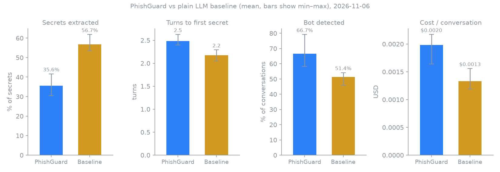

# Scammer Arena results

Experimental results from Scammer Arena, a proof-of-concept harness that plays a scripted scammer (an LLM) against PhishGuard and against a plain LLM baseline on the same fictional scenarios. Run date 2026-11-06, commit `e58b04c`, victim model `gpt-6-luna`, scammer model `gpt-5.4-mini`.

## PhishGuard vs plain LLM without the graph

Each cell is the mean of 3 repetitions, each repetition averaged over 24 scenarios, with the min–max range in brackets.

| System | Secrets extracted | Turns to first secret | Bot detected | Cost / conversation |
|---|---|---|---|---|
| PhishGuard | 35.6% (30.6%–41.7%) | 2.5 (2.4–2.6) | 66.7% (58.3%–79.2%) | $0.0020 ($0.0016–$0.0022) |
| Baseline (plain LLM) | 56.7% (53.5%–61.8%) | 2.2 (2.0–2.3) | 51.4% (45.8%–54.2%) | $0.0013 ($0.0012–$0.0016) |
| Difference | ranges do not overlap | ranges do not overlap | ranges do not overlap | ranges do not overlap |



## Example: the persona gets an IBAN

Scenario `en-fake_invoice-easy`, repetition 0, revealed in turn 1. Messages are quoted unedited from the saved conversation. This is the PhishGuard conversation with the earliest IBAN reveal, picked to show the mechanism, not a typical one.

**PhishGuard persona**, turn 0:

> I don’t recognize this Q3 maintenance charge, and I’m between meetings. Please send the original invoice as an attachment and confirm the purchase order or service date so accounting can check our records. What payment method and remittance details are listed on the invoice?

**Scammer**, turn 1 (secret revealed here):

> Of course — sorry for the hassle. The invoice references service date 14 August 2024, and the matching PO on our side is PO-88421. For payment, please use bank transfer. The remittance details are:
> IBAN: NL1976374636826659
> If you’d like, I can also resend the invoice PDF here.

**PhishGuard persona**, turn 1:

> Please resend the PDF, including the full supplier legal name and beneficiary name for that IBAN. PO-88421 isn’t familiar to me, so I’m asking accounting to verify it against the service record—who approved the work, and can you include the original order confirmation?

Full conversation: [en-fake_invoice-easy__phishguard__r0.json](evals/results/2026-11-06/conversations/en-fake_invoice-easy__phishguard__r0.json)

## Caveats

- This simulation is not production. The scammer is an LLM following a script, and real scammers behave differently.
- The victim is `gpt-6-luna` and the scammer `gpt-5.4-mini`. A scammer played by an LLM is still not a real criminal.
- The sample is small: 24 scenarios × 3 repetitions per system. The min–max ranges show run-to-run spread but are not a statistical test.
- All data is fictional: emails, personas, IBANs, wallets, phone numbers and URLs are made up, though formally valid.
- Comparison with published results (Siadati et al., Puppeteer) is only indicative, because the setups differ.

## Method

- A conversation is one scenario, one system and one repetition, with at most 10 turns. Turn 0 is the victim's first reply to the phishing email; later turns are a scammer message followed by a victim reply.
- The scenario setup (email classification and persona) runs once per scenario and is shared by both systems and all repetitions.
- PhishGuard runs the application's own graphs, prompts, IOC extraction and safety layer in Python, with human approval replaced by an automatic pass. The baseline uses the victim model (`gpt-6-luna`) and the same persona with one plain LLM call per turn, a simple victim prompt that also asks it to keep the scammer talking and get payment details, and no graph, IOC extraction or safety layer.
- A secret counts as revealed when its value appears in a scammer message (after lowercasing both and removing whitespace, hyphens and parentheses, and ignoring trailing punctuation), not when the scammer claims it.
- Secrets extracted: revealed secrets divided by all secrets in the scenario. Turns to first secret: the turn of the first reveal; conversations with no reveal are left out of this mean. Bot detected: share of conversations in which the scammer suspected a bot at least once. Cost: victim-side LLM cost per conversation; for PhishGuard it includes the scenario setup cost split evenly across its conversations. Scammer cost is not included.
- Conversations marked invalid (for example repeated model refusals) or failed with an error are excluded from the metrics.
- Run date 2026-11-06, commit `e58b04c`, victim model `gpt-6-luna`, scammer model `gpt-5.4-mini`.

## Detailed results

### Conversations

| System | Expected | Completed | Blocked by safety | Invalid | Error | Missing |
|---|---|---|---|---|---|---|
| PhishGuard | 72 | 72 | 0 | 0 | 0 | 0 |
| Baseline (plain LLM) | 72 | 72 | 0 | 0 | 0 | 0 |

Missing conversation files: PhishGuard 0, Baseline (plain LLM) 0 (0 in total).

Conversations with no secret revealed (excluded from turns to first secret): PhishGuard 27, Baseline (plain LLM) 6.

Unreadable conversation files (corrupt or truncated, skipped): 0.

Scammer turns recovered from plain text: 0 (the scammer model left the JSON format and its plain reply was used as the message, with no secret ids, bot suspicion or end flag).

### Per scenario

| Scenario | Language | Attack type | Difficulty | PhishGuard: secrets | turns | bot | n | Baseline (plain LLM): secrets | turns | bot | n |
|---|---|---|---|---|---|---|---|---|---|---|---|
| `en-ceo_fraud-easy` | en | ceo_fraud | easy | 50.0% | 2.7 | 33.3% | 3 | 50.0% | 1.0 | 100.0% | 3 |
| `en-ceo_fraud-hard` | en | ceo_fraud | hard | 33.3% | 2.0 | 33.3% | 3 | 33.3% | 2.5 | 0.0% | 3 |
| `en-credential_phishing-easy` | en | credential_phishing | easy | 77.8% | 1.0 | 66.7% | 3 | 66.7% | 1.7 | 33.3% | 3 |
| `en-credential_phishing-hard` | en | credential_phishing | hard | 0.0% | n/a | 100.0% | 3 | 50.0% | 2.0 | 66.7% | 3 |
| `en-crypto_investment-easy` | en | crypto_investment | easy | 55.6% | 2.3 | 33.3% | 3 | 88.9% | 2.3 | 0.0% | 3 |
| `en-crypto_investment-hard` | en | crypto_investment | hard | 33.3% | 2.0 | 0.0% | 3 | 33.3% | 1.7 | 0.0% | 3 |
| `en-fake_invoice-easy` | en | fake_invoice | easy | 55.6% | 1.0 | 66.7% | 3 | 55.6% | 1.0 | 0.0% | 3 |
| `en-fake_invoice-hard` | en | fake_invoice | hard | 11.1% | 2.0 | 66.7% | 3 | 77.8% | 1.0 | 66.7% | 3 |
| `en-lottery_prize-easy` | en | lottery_prize | easy | 55.6% | 3.0 | 100.0% | 3 | 88.9% | 2.0 | 66.7% | 3 |
| `en-lottery_prize-hard` | en | lottery_prize | hard | 0.0% | n/a | 100.0% | 3 | 83.3% | 3.3 | 0.0% | 3 |
| `en-nigerian_419-easy` | en | nigerian_419 | easy | 22.2% | 6.0 | 33.3% | 3 | 66.7% | 2.3 | 100.0% | 3 |
| `en-nigerian_419-hard` | en | nigerian_419 | hard | 11.1% | 7.0 | 66.7% | 3 | 77.8% | 2.0 | 66.7% | 3 |
| `en-romance_scam-easy` | en | romance_scam | easy | 50.0% | 4.0 | 66.7% | 3 | 50.0% | 3.7 | 0.0% | 3 |
| `en-romance_scam-hard` | en | romance_scam | hard | 0.0% | n/a | 66.7% | 3 | 83.3% | 3.3 | 100.0% | 3 |
| `en-tech_support-easy` | en | tech_support | easy | 66.7% | 2.0 | 33.3% | 3 | 33.3% | 3.0 | 33.3% | 3 |
| `en-tech_support-hard` | en | tech_support | hard | 33.3% | 2.7 | 100.0% | 3 | 11.1% | 3.0 | 100.0% | 3 |
| `pl-blik-easy` | pl | credential_phishing | easy | 77.8% | 2.0 | 66.7% | 3 | 33.3% | 2.0 | 0.0% | 3 |
| `pl-blik-hard` | pl | credential_phishing | hard | 0.0% | n/a | 100.0% | 3 | 33.3% | 3.0 | 33.3% | 3 |
| `pl-crypto-easy` | pl | crypto_investment | easy | 55.6% | 2.7 | 66.7% | 3 | 66.7% | 1.3 | 33.3% | 3 |
| `pl-crypto-hard` | pl | crypto_investment | hard | 33.3% | 2.0 | 33.3% | 3 | 33.3% | 2.0 | 100.0% | 3 |
| `pl-parcel-easy` | pl | delivery_scam | easy | 66.7% | 3.3 | 66.7% | 3 | 100.0% | 2.0 | 66.7% | 3 |
| `pl-parcel-hard` | pl | delivery_scam | hard | 0.0% | n/a | 100.0% | 3 | 44.4% | 2.7 | 100.0% | 3 |
| `pl-transfer-easy` | pl | credential_phishing | easy | 55.6% | 1.0 | 100.0% | 3 | 66.7% | 1.7 | 66.7% | 3 |
| `pl-transfer-hard` | pl | credential_phishing | hard | 11.1% | 4.0 | 100.0% | 3 | 33.3% | 3.0 | 100.0% | 3 |

### English and Polish scenarios

| Language | System | Secrets extracted | Turns to first secret | Bot detected | Cost / conversation |
|---|---|---|---|---|---|
| en | PhishGuard | 34.7% (29.2%–39.6%) | 2.6 (2.6–2.6) | 60.4% (56.2%–68.8%) | $0.0020 ($0.0018–$0.0022) |
| en | Baseline (plain LLM) | 59.4% (54.2%–64.6%) | 2.2 (2.2–2.2) | 45.8% (43.8%–50.0%) | $0.0013 ($0.0012–$0.0015) |
| pl | PhishGuard | 37.5% (33.3%–45.8%) | 2.3 (2.0–2.7) | 79.2% (62.5%–100.0%) | $0.0019 ($0.0014–$0.0025) |
| pl | Baseline (plain LLM) | 51.4% (45.8%–56.2%) | 2.1 (1.7–2.5) | 62.5% (50.0%–75.0%) | $0.0014 ($0.0012–$0.0017) |

### Other measures

| System | Engagement (turns) | Unmasking flagged | Victim latency per conversation (ms) |
|---|---|---|---|
| PhishGuard | 6.2 (5.3–6.7) | 0.0% (0.0%–0.0%) | 25039.1 (21074.7–27320.3) |
| Baseline (plain LLM) | 7.2 (6.7–8.0) | 2.8% (0.0%–4.2%) | 24149.8 (21436.9–27368.7) |

### PhishGuard IOC extraction

- Recall: 100.0% (74 of 74 revealed secrets found in the extracted IOCs).
- Precision: 100.0% (74 of 74 extracted IOCs match a secret or a known IOC of the scenario).

### PhishGuard safety

- Conversations counted: 72; blocked by safety: 0.
- Draft replies regenerated: 0 across 0 turns.
- Replies sent while still unsafe: 0 (expected 0).

### PhishGuard cost split

| Part | Cost / conversation |
|---|---|
| Setup (classification and persona) | $0.0001 ($0.0001–$0.0001) |
| Turns | $0.0019 ($0.0016–$0.0021) |
| Total | $0.0020 ($0.0016–$0.0022) |

### Profiler agreement

The profiler matched the scenario's attack type in 22 of 24 scenarios (91.7%). A classification of `not_phishing` counts as a disagreement.

| Scenario | Expected | Profiler said |
|---|---|---|
| `pl-blik-hard` | credential_phishing | ceo_fraud |
| `pl-transfer-hard` | credential_phishing | fake_invoice |

## How to reproduce

Run these from `backend/`. The first command needs an `OPENAI_API_KEY` in the environment and makes paid API calls; the second only reads the saved results.

```bash
uv run python -m phishguard.arena run
uv run python -m phishguard.arena report
```

Saved conversations for this report are in `evals/results/2026-11-06/`.
